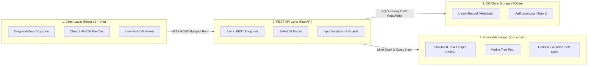

# Digital Identity Verification Using Blockchain
## 8-Slide Presentation Script, Content & Speaker Notes (5–7 Minute Presentation)

> **Generated PowerPoint File**: [`Digital_Identity_Verification.pptx`](file:///c:/Users/keert/Desktop/Block%20Chain/Digital_Identity_Verification.pptx)  
> **Exact Location**: `C:\Users\keert\Desktop\Block Chain\Digital_Identity_Verification.pptx`  
> **Target Duration**: 5 to 7 Minutes  
> **Audience**: College Professors, Examiners, and Engineering Students  
> **Theme**: Professional Dark-Blue Theme (`#0B132B`, `#1C2541`, `#38BDF8`, `#10B981`, `#EF4444`)

---

## Slide 1: Title Slide
- **Slide Title**: Digital Identity Verification Using Blockchain
- **Subtitle**: A Privacy-Preserving, Tamper-Proof Credential Verification System Using SHA-256 & Proof-of-Work
- **Category Badge**: Academic Capstone Project • 2024–2025
- **Team Information**:
  - **Team Member 1**: [Name & Roll No] — *Frontend & Verification Interface*
  - **Team Member 2**: [Name & Roll No] — *FastAPI Backend & Cryptographic Engine*
  - **Team Member 3**: [Name & Roll No] — *Simulated Proof-of-Work Blockchain & Merkle Trees*
  - **Team Member 4**: [Name & Roll No] — *Database Architecture, Automated Testing & Documentation*
- **Department**: Department of Computer Science & Engineering
- **Faculty Guide**: Prof. [Faculty Guide Name]

### 🗣️ Speaker Notes (30–45 seconds)
> "Good morning respected professors and fellow students. Today, our group presents our capstone project: **'Digital Identity Verification Using Blockchain'**.  
> In today's digital world, credentials like degrees, national IDs, and certificates are constantly shared online, but verifying their authenticity without leaking private personal data remains a major challenge.  
> We have built a full-stack, working system that solves this problem using SHA-256 cryptographic hashing and a decentralized Proof-of-Work blockchain ledger."

---

## Slide 2: Introduction & Problem Statement
- **Slide Title**: Introduction & Problem Statement
- **Subtitle / Badge**: System Context & Motivation

### Current Challenges & Vulnerabilities (Left Column)
- **Centralized Vulnerability**: Traditional identity records reside in centralized servers, creating single points of failure prone to unauthorized tampering and server outages.
- **Easy Document Forgery**: Digital PDFs, scans, and ID images can be seamlessly modified using basic image editors, making visual human inspection unreliable.
- **Privacy & PII Leakage**: Storing raw identity documents on public databases or public blockchains violates privacy regulations (such as GDPR) and exposes users to identity theft.
- **Slow Verification Cycles**: Manual background checks require days or weeks of contacting original issuing authorities.

### Our Blockchain-Powered Solution (Right Column)
- **Zero-PII On-Chain Storage**: No personal names or raw documents are ever recorded on-chain. Only irreversible 256-bit SHA-256 mathematical hashes are anchored.
- **Instant Tamper Detection (Avalanche Effect)**: Changing even a single character in a document completely transforms its SHA-256 digest, triggering an immediate Tamper Alert.
- **Immutable Proof-of-Work Ledger**: Once a block is mined and chained, historical records cannot be altered, deleted, or backdated.
- **Self-Sovereign Real-Time Audit**: Any verifier can check a document in milliseconds without depending on slow third-party intermediaries.

### 🗣️ Speaker Notes (45–60 seconds)
> "Why do traditional identity systems fail? First, central databases can be hacked or altered. Second, digital documents like PDFs are easily forged with Photoshop. Third, we cannot simply put identity documents onto a blockchain because storing personal data publicly violates privacy laws.  
> Our system introduces a **Zero-PII** philosophy: we never put the document or personal details on the blockchain. Instead, we generate a 256-bit mathematical fingerprint using SHA-256 and store only that fingerprint on an immutable Proof-of-Work ledger. This makes tampering mathematically impossible while keeping personal data 100% private."

---

## Slide 3: Objectives of the Project
- **Slide Title**: Project Objectives & Scope
- **Subtitle / Badge**: Project Goals

### 4 Core Objectives
1. **01 — Zero-PII Cryptographic Anchoring**:
   - Hash documents client- and server-side using SHA-256.
   - Keep sensitive holder data off-chain while anchoring mathematical fingerprints to the ledger.
2. **02 — Custom Proof-of-Work Blockchain Ledger**:
   - Develop a transparent, educational blockchain engine featuring difficulty-targeted mining (`00...`), Merkle roots, previous hash linkage, and chain integrity validation (`is_chain_valid`).
3. **03 — Real-Time Tamper Detection Engine**:
   - Deliver instantaneous mathematical audit capabilities comparing computed file hashes against on-chain records with clear Match (Green) vs. Tamper (Red) visual notifications.
4. **04 — Full-Stack Production-Ready Web Interface**:
   - Implement a responsive React 19 single-page app and FastAPI backend with interactive drag-and-drop verification, block explorer, and audit history.

### 🗣️ Speaker Notes (45 seconds)
> "Our project set four clear engineering objectives:  
> First, ensure complete privacy through Zero-PII cryptographic anchoring.  
> Second, build an authentic Proof-of-Work blockchain engine with Merkle trees and difficulty-based mining.  
> Third, provide real-time tamper detection where any altered file is caught instantly.  
> Fourth, create a polished, full-stack web application so non-technical users can drag, drop, and verify credentials effortlessly."

---

## Slide 4: System Architecture & Workflow Diagram
- **Slide Title**: System Architecture & Workflow Diagram
- **Subtitle / Badge**: Technical Architecture

### 4 Architectural Tiers

### Core Workflows:
- **Registration Flow**:
  `User inputs ID + Document` ➔ `FastAPI computes SHA-256` ➔ `PoW miner solves block (difficulty=2)` ➔ `Block appended to chain` ➔ `Metadata & Tx Hash stored in SQLite` ➔ `Receipt returned`.
- **Verification Flow**:
  `Verifier uploads file` ➔ `FastAPI computes fresh SHA-256` ➔ `Queries registered hash from Blockchain` ➔ `Bitwise comparison` ➔ `Match (Green Confirmed) or Mismatch (Red Tamper Alert)` ➔ `Logged in Verification History`.

### 🗣️ Speaker Notes (60 seconds)
> "Here is our 4-tier system architecture:  
> At Tier 1, the user interacts with a React 19 single-page app featuring drag-and-drop file inputs and client-side hash pre-calculation.  
> At Tier 2, our FastAPI backend receives the request, computes the SHA-256 hash, and enforces validation.  
> At Tier 3, off-chain metadata such as the holder's name, email, and audit logs are safely stored in an SQLite relational database. Note that raw document contents are never stored in the database.  
> At Tier 4, the document hash is mined into an immutable block using our Proof-of-Work blockchain.  
> The system also includes dual-mode flexibility, capable of interacting with either our built-in simulated ledger or a local Ethereum Ganache smart contract."

---

## Slide 5: Technologies Used
- **Slide Title**: Technologies Used in Implementation
- **Subtitle / Badge**: Tech Stack Breakdown

### Frontend Technologies
- **React 19 & Vite**: Ultra-fast single-page web framework with instantaneous Hot Module Replacement.
- **Tailwind CSS & Glassmorphism**: Clean, modern dark-blue theme with glowing status badges and tab-based routing.
- **Web Crypto API**: Client-side SHA-256 preview calculation before files are submitted to the server.

### Backend Technologies
- **Python 3.11 & FastAPI**: Asynchronous REST API framework providing native type checking and high throughput.
- **Uvicorn ASGI Server**: High-performance asynchronous server gateway interface.
- **Pydantic v2**: Strict schema validation and structured payload handling.

### Cryptography & Blockchain Core
- **SHA-256 (Secure Hash Algorithm)**: One-way 256-bit cryptographic digest generating fixed 64-character hex strings.
- **Simulated PoW Blockchain**: Built-in Python blockchain ledger with adjustable mining difficulty (difficulty=2), Merkle trees, and genesis block initialization.
- **Avalanche Effect**: Cryptographic guarantee that modifying 1 bit alters approximately 50% of the output hash.

### Database & Smart Contracts (Optional / Dual-Mode)
- **SQLite & SQLAlchemy ORM**: Lightweight relational database for persistent metadata and audit logs.
- **Dual-Mode Blockchain Switch**: Supports both the zero-dependency simulated ledger and local Ganache EVM.
- **Solidity Smart Contract (`IdentityVerification.sol`)**: Compiled EVM contract for decentralized on-chain mapping via Web3.py.

### 🗣️ Speaker Notes (45 seconds)
> "Every technology used in this presentation is fully implemented in our repository:  
> On the frontend, we use React 19 with Vite and Tailwind CSS.  
> On the backend, we use Python 3.11 with FastAPI for asynchronous performance.  
> In cryptography, we use SHA-256 to produce irreversible 64-character hexadecimal digests.  
> For the blockchain, we built a Python Proof-of-Work ledger with Merkle root computation, and also included a ready-to-deploy Solidity smart contract for local Ganache testnets."

---

## Slide 6: Working Process
- **Slide Title**: Working Process: Step-by-Step Flow
- **Subtitle / Badge**: System Execution

### The 4 Execution Steps:
1. **Step 01 — Document Upload & Sanitization**:
   - The user submits an identity credential (`.txt`, `.pdf`, `.png`).
   - A unique identifier is assigned (e.g., `STU-2024-8841`).
   - The backend validates the byte stream and rejects empty (0-byte) files.
2. **Step 02 — SHA-256 Hash Generation**:
   - The binary file stream is processed through SHA-256.
   - Produces a unique 64-character hexadecimal fingerprint.
   - The operation is deterministic and mathematically one-way (irreversible).
3. **Step 03 — Blockchain Record Commitment**:
   - The Identity ID and Document Hash are bundled into a transaction.
   - Proof-of-Work mining iterates nonces until the block hash satisfies difficulty (starts with `00...`).
   - Transactions are structured into a Merkle tree and the block is chained to `previous_hash`.
4. **Step 04 — Cryptographic Hash Comparison**:
   - During verification, the verifier uploads the document under test.
   - The server computes the fresh SHA-256 hash and fetches the registered hash from the blockchain.
   - If hashes match: **100% Cryptographic Match** (Authentic).
   - If hashes differ: **Tamper Alert Detected** (Document Modified).

### Mathematical Verification Principle:
$$\text{Registered Hash } H_{\text{reg}} = \text{SHA-256}(\text{Document}_{\text{original}})$$
$$\text{Audit Hash } H_{\text{test}} = \text{SHA-256}(\text{Document}_{\text{uploaded}})$$
$$\text{Decision} = \begin{cases} \text{VALID (Authentic)}, & \text{if } H_{\text{test}} = H_{\text{reg}} \\ \text{TAMPER ALERT}, & \text{if } H_{\text{test}} \neq H_{\text{reg}} \end{cases}$$

### 🗣️ Speaker Notes (60 seconds)
> "Let's walk through the exact working process.  
> Step 1: An identity document is uploaded and sanitized.  
> Step 2: The system computes its 64-character SHA-256 hash. Because SHA-256 is a one-way function, the document can never be reconstructed from this hash.  
> Step 3: The hash is bundled into a transaction and mined into a block using Proof of Work, where it receives a block number and transaction hash.  
> Step 4: When someone wants to verify the document later, they simply upload the file. The system calculates its fresh hash and compares it against the blockchain record. If all 64 characters match, the document is 100% genuine. If even a single punctuation mark was changed, the hashes diverge completely."

---

## Slide 7: Live Demonstration & Limitations
- **Slide Title**: Live Demonstration, Test Results & Limitations
- **Subtitle / Badge**: Testing & Real-World Scope

### Implemented Live Demo Scenarios (Left Column)
- **1. Authentic Document Test (`aarav_student_id.txt`)**:
  - Identity ID: `STU-2024-8841` (Aarav Sharma).
  - Uploading genuine document results in exact SHA-256 match.
  - UI displays glowing green **"100% CRYPTOGRAPHIC MATCH"** with Block # and Tx Hash.
- **2. Tampered Document Test (`tampered_aarav_student_id.txt`)**:
  - Only one single character modified in the file.
  - Due to the Avalanche Effect, the resulting hash is completely different.
  - UI triggers glowing red **"TAMPER ALERT DETECTED"** with visual side-by-side hash diff.
- **3. Blockchain Explorer & Integrity Audit**:
  - Live timeline from Genesis Block #0 to the latest block.
  - 1-click **"Re-Audit Chain Integrity"** button verifies all block links via `is_chain_valid()`.
- **4. Automated Backend Test Suite**:
  - 8 out of 8 automated tests pass (100% Green), verifying hashing determinism, duplicate rejection, and sensitivity.

### Honest System Limitations (Right Column)
- **Simulated In-Memory Ledger**: The simulated blockchain resides in memory; while metadata persists in SQLite, block structures reset on server restart unless persisted.
- **Private Ganache EVM Environment**: Smart contracts are tested on a local Ganache private testnet, avoiding real cryptocurrency gas fees and network latency. The system is not connected to public Ethereum mainnet.
- **"Garbage In, Garbage Out" Boundary**: Blockchain proves that a document has not been altered since registration; it cannot independently prove that the document was genuine before registration without institutional multi-signature signers.
- **Local File Storage**: Uploaded test files are stored on the local server rather than decentralized file networks like IPFS.

### 🗣️ Speaker Notes (60 seconds)
> "During our live demonstration, we show two key test cases:  
> First, uploading Aarav Sharma's authentic Student ID results in a glowing green '100% Cryptographic Match' on Block #1.  
> Second, modifying even one character in that document triggers an immediate glowing red 'Tamper Alert Detected', highlighting the exact hash discrepancy.  
> To remain academically rigorous, we also acknowledge our project's limitations:  
> Our default blockchain is an in-memory simulated ledger, our EVM tests run on local Ganache rather than public Ethereum to avoid real transaction fees, and like all blockchain systems, it verifies post-registration immutability rather than initial truthfulness."

---

## Slide 8: Conclusion & Future Enhancements
- **Slide Title**: Conclusion & Future Roadmap
- **Subtitle / Badge**: Project Wrap-Up

### Project Achievements & Summary (Left Column)
- **Privacy By Design**: Proven that credential verification can be achieved without storing sensitive personal data on-chain.
- **Uncompromising Tamper Detection**: Cryptographic hashing catches any unauthorized modifications with 100% mathematical precision.
- **Working End-to-End System**: Engineered a complete platform from responsive React frontend to custom Proof-of-Work blockchain.
- **100% Automated Test Pass**: All 8 backend cryptographic and API test suites verified green.

### Future Enhancements & Roadmap (Right Column)
- **Decentralized Storage (IPFS Integration)**: Store client-side encrypted credential files on IPFS and anchor only Content Identifiers (CIDs) on-chain.
- **Zero-Knowledge Proofs (zk-SNARKs)**: Allow users to prove attributes (e.g., 'Age >= 18' or 'Has Valid Degree') without revealing their identity or document text.
- **Multi-Signature Institutional Issuers**: Require verified digital signatures from universities or government issuing bodies before an identity hash is committed.
- **Public Layer-2 Deployment**: Deploy Solidity contracts to public Layer-2 EVM networks (e.g., Polygon or Arbitrum) for low-cost global decentralization.

### 🗣️ Speaker Notes (45 seconds)
> "In conclusion, our project demonstrates a practical, privacy-compliant, and tamper-proof digital identity verification system. We have replaced slow, centralized verification with fast, decentralized cryptographic mathematics.  
> For future work, we plan to integrate IPFS for encrypted decentralized file storage, implement Zero-Knowledge Proofs so users can prove qualifications without revealing their identity, and deploy to public Layer-2 blockchains like Polygon.  
> Thank you, and we are now ready for your questions!"

---

## 🎯 Quick Presentation Q&A Preparation for Examiners

| Question from Professor / Examiner | Recommended Answer based on this Project |
| :--- | :--- |
| **Q1: Why did you not store the user's name and document directly on the blockchain?** | "Storing personal data on a public or shared blockchain violates privacy laws like GDPR because blockchain data is permanently immutable and publicly readable. By storing only the SHA-256 hash, we ensure Zero-PII on-chain while retaining 100% mathematical proof of document authenticity." |
| **Q2: What is the Avalanche Effect and why is it important here?** | "The Avalanche Effect is a fundamental property of SHA-256 where modifying even a single character or byte causes more than 50% of the output bits to change unpredictably. This ensures that even the smallest forgery is instantly detected during hash comparison." |
| **Q3: What consensus algorithm is used in your simulated blockchain?** | "We implemented Proof-of-Work (PoW). During block creation, the miner repeatedly increments a nonce until the block's SHA-256 hash starts with the required number of leading zeros (target difficulty=2 in our demo), simulating Bitcoin's consensus mechanism." |
| **Q4: Is this project connected to the public Ethereum mainnet?** | "No, it is intentionally configured in dual-mode: by default, it uses our built-in zero-dependency simulated PoW ledger in Python. When Ethereum mode is selected, it connects to a local Ganache EVM testnet. This allows full smart contract testing without requiring real cryptocurrency or incurring gas costs." |
| **Q5: How does the system handle duplicate registrations?** | "Our FastAPI backend and SQLite database enforce uniqueness on `identity_id`. In our automated test suite, Test Case 1 verifies that attempting to register the same Identity ID a second time is immediately rejected with an HTTP 400 Bad Request error." |
